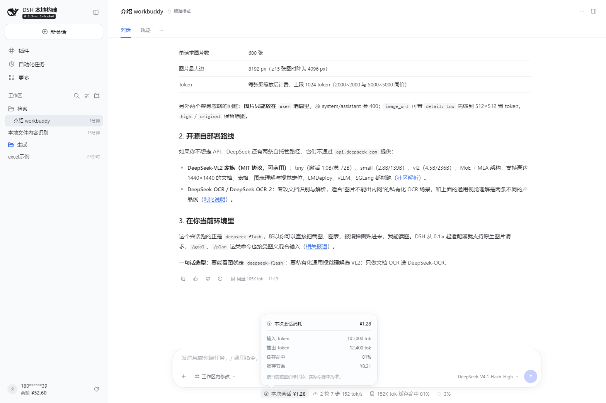
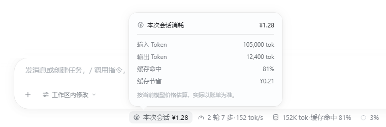

# DSH Balance UI

一个给 [DeepSeek Harness (DSH)](https://github.com/deepseek-ai/deepseek-harness) 用的轻量余额插件：在输入框下方显示本次会话预估消耗，在侧栏显示账户余额（充值 + 赠送）并支持手动刷新。



> 界面预览（设计稿，示例数据；余额条位于账号入口**上方**）。会话金额按内置单价估算，不代表 Platform 账单。

## 功能

### 本次会话消耗

- 在 `conversation.composer.dock` 新增统计入口，位于原有轮次 / Token 统计之前
- 显示本次会话的预估费用
- 点击金额打开明细卡：
  - 输入 Token
  - 输出 Token
  - 缓存命中
  - 缓存节省
  - 估算说明
- 点击外部或按 `Escape` 关闭
- 不使用浏览器原生 tooltip，避免和浮层重复



### 账户余额

- 在侧栏账号入口上方新增余额条
- 显示 **充值余额 + 赠送余额** 的合计（按币种分别求和，主显示 CNY）
- 悬停显示「充值 ¥xx · 赠送 ¥xx」分项
- 点击刷新图标重新读取，图标旋转并在完成后短暂显示绿色更新点
- 通过 `aria-live` 播报最新余额
- 同一浏览器的多个标签/窗口通过 `BroadcastChannel` 同步刷新结果：任一页面刷新成功后，其他页面立即更新，不重复请求账户接口
- 页面重新可见时会再拉取一次，兜底处理隐藏期间可能错过的更新

> 同步范围仅限同源、同一浏览器 profile 的标签/窗口；不跨浏览器 profile 或跨设备。

## 安装

### 通过 DSH 插件页

1. 打开 DSH → 左侧 **插件** → **添加插件**
2. 填入：

   ```text
   github:Asukabye/dsh-balance-ui
   ```

   或 GitHub 地址：

   ```text
   https://github.com/Asukabye/dsh-balance-ui
   ```

3. 安装完成后刷新 DSH 页面

### 通过 CLI

```bash
dsh plugin --profile web add github:Asukabye/dsh-balance-ui
```

自定义 profile 时把 `web` 换成实际 profile 名。安装后重新启动 DSH。

> DSH Desktop 请使用插件页安装，不要手动执行 `dsh plugin --profile desktop`。

### 本地 tarball

```bash
dsh plugin --profile web add "/absolute/path/to/local-dsh-balance-ui-1.0.0.tgz"
```

安装前建议完全退出 DSH，安装后重新启动。

### 通过 DSH Agent

把仓库地址或本地 tarball 路径发给 DSH Agent，请它通过 `plugin_manager` 安装。

## 数据与计算

会话费用读取持久化的 `tokenUsage` projection，按 `client.js` 中的 `RATES` 估算，单位为 CNY / 百万 token：

| 项目 | 单价 |
|---|---:|
| 未命中缓存的输入 | ¥2.00 / M |
| 缓存命中 | ¥0.20 / M |
| 输出 | ¥3.00 / M |

缓存节省 = 缓存读取 token ×（输入单价 − 缓存命中单价）。

账户余额通过 DSH 的 `remote.account.getBalance` 读取真实的充值钱包和赠送钱包。只有已登录 DeepSeek 账号时才有可读账户余额；仅配置 API Key 时余额条不会显示。

## 兼容性

- 建议 DSH `0.2.2` 及以上
- 使用 `conversation.composer.dock`、`sidebar.footer.action` 和 `remote.account`
- 纯 JavaScript，无第三方依赖、无安装脚本

## 实现说明

`settings.launcher` 是账号插件占用的 single slot，直接替换会移除现有账号菜单和退出登录流程。因此余额条采用增量 `sidebar.footer.action`，位于账号入口正上方，不覆盖原账号行。

## 文件

```text
client.js            Client 模块：两个 UI 入口
index.js             Host 模块（空 apply）
cordis.patch.yml     Bundle 插入行
locale/              插件管理器展示文案
icon.svg             插件图标
docs/                README 预览图
```

## 卸载

在 DSH 插件页的「已安装插件」中移除，或让 Agent 调用 `plugin_manager` 的 `remove_bundle`。

CLI：

```bash
dsh plugin --profile web remove @local/dsh-balance-ui
```

## License

MIT
